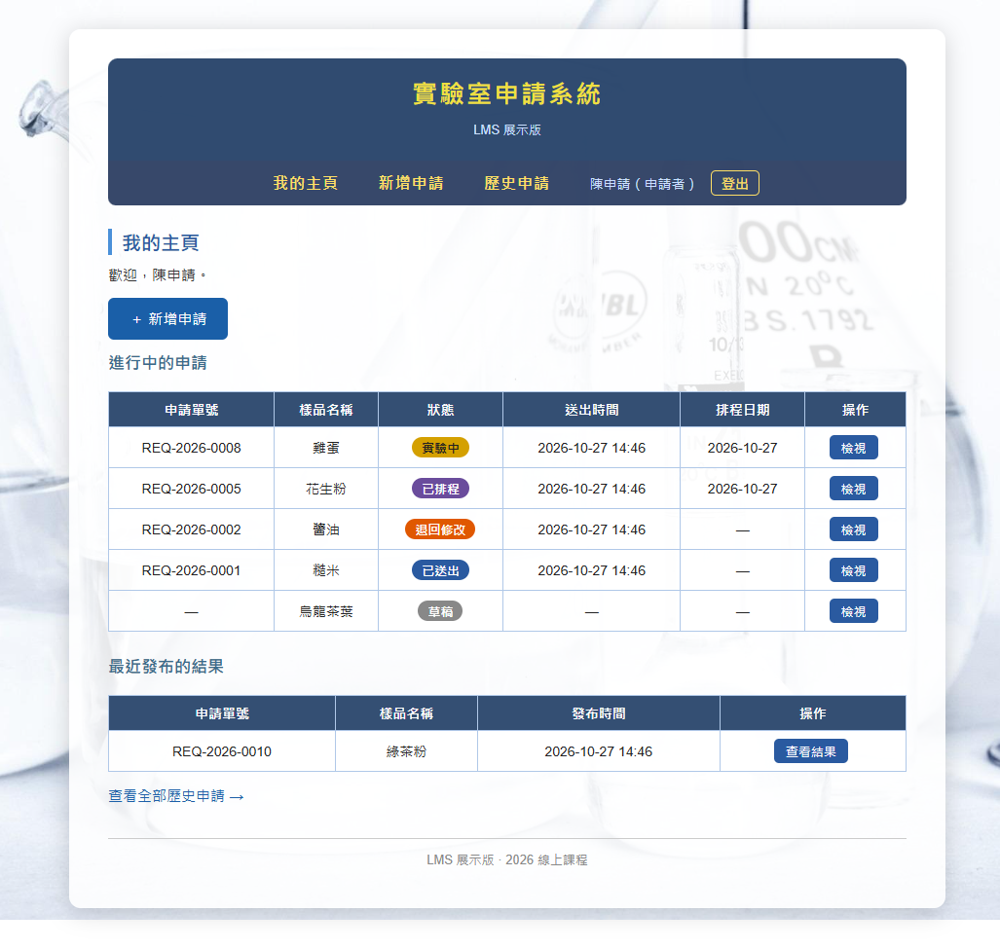
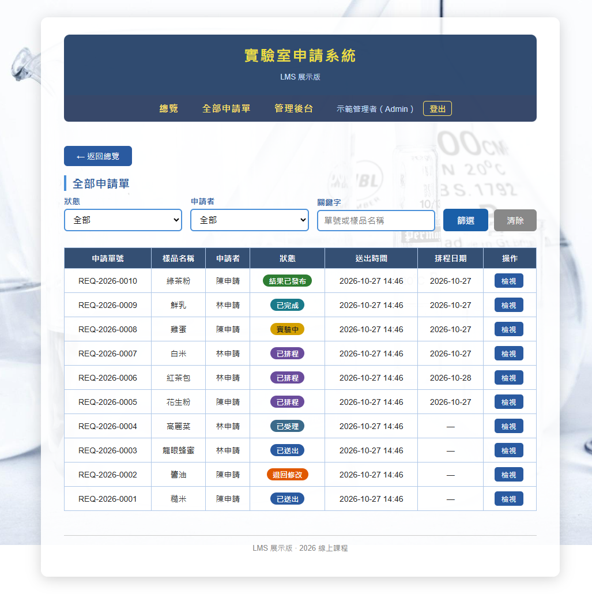
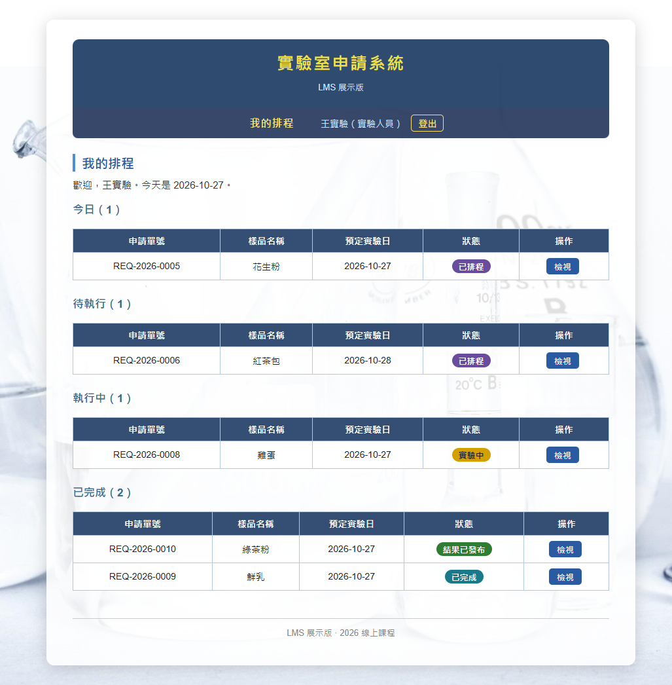
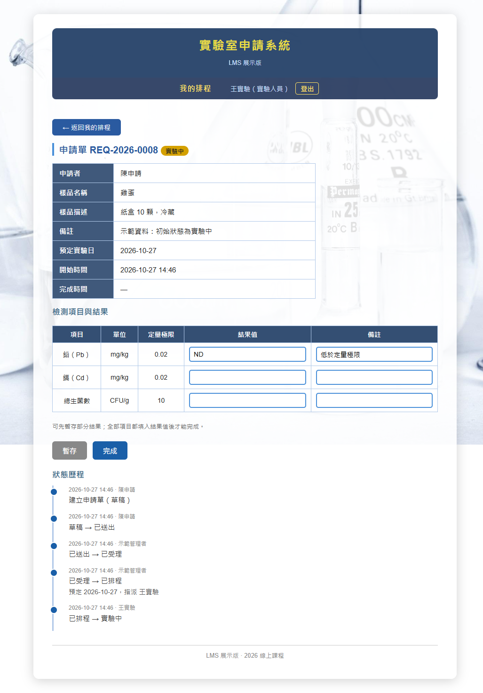
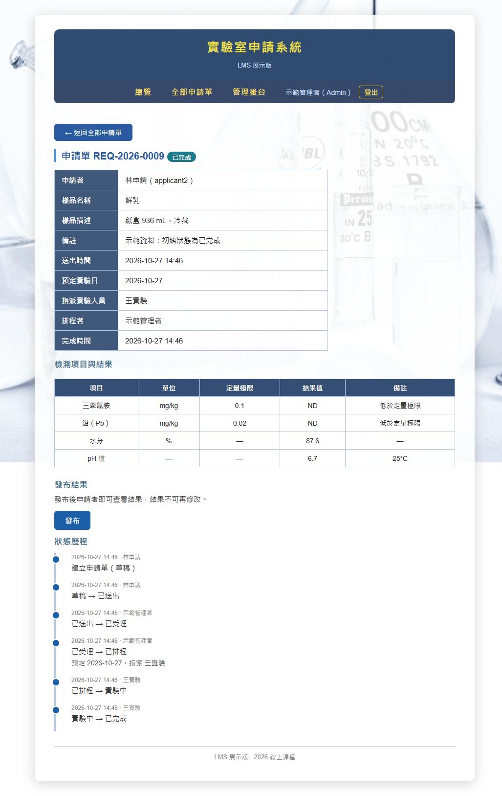
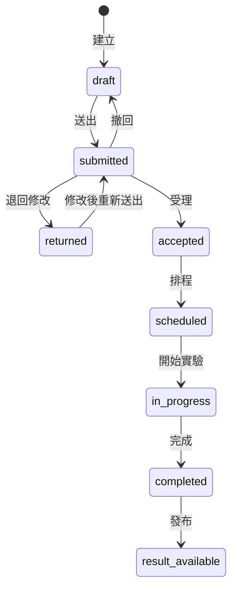

# LMS Lite：實驗室申請管理系統（展示版）

以 Django 開發的實驗室申請管理系統，展示**申請者、Admin、實驗人員**三種角色之間的完整資料流：從申請、受理、排程、實驗、輸入結果到發布結果。

設計重點放在實驗室最在意的兩件事：**數據可追溯**與**權限隔離**。所有狀態變更集中在單一服務模組並留下完整歷程，各角色只能存取屬於自己的資料。

- **線上展示**：https://lms-lite-demo-6b4412ed2069.herokuapp.com/
- **註冊邀請碼**：`LMSDEMO`（註冊後為申請者角色）
- **展示投影片**：[docs/LMS_Lite_Demo_Slides.pdf](docs/LMS_Lite_Demo_Slides.pdf)

> Admin 與實驗人員的操作流程不開放公開帳號，可參考下方截圖與展示投影片，或於面試時現場展示。

---

## 畫面

以下依資料流的順序排列。

### 1. 申請者主頁：進行中的申請與已發布的結果



### 2. Admin 全部申請單：依狀態、申請者、關鍵字篩選



### 3. 實驗人員我的排程：依今日、待執行、執行中、已完成分區



### 4. 實驗人員結果輸入：可暫存部分結果，全部填入後才能完成



### 5. Admin 檢視結果並發布，下方為完整的狀態歷程



---

## 流程概覽

```text
申請者：建立申請 → 送出
    ↓
Admin：受理（或退回修改）→ 排程並指派實驗人員
    ↓
實驗人員：開始實驗 → 逐項輸入結果 → 完成
    ↓
Admin：檢視結果 → 發布
    ↓
申請者：在個人主頁查看結果與歷史申請
```

---

## 設計重點

### 1. 單一事實來源：狀態只存在 `Request.status`

申請單的狀態只記錄在一個欄位。排程（`Schedule`）不另設狀態欄位，排程畫面上的狀態一律讀取申請單，避免兩處狀態不同步。



| 轉換 | 從 | 到 | 操作者 | 前提與副作用 |
|---|---|---|---|---|
| 送出 | 草稿、退回修改 | 已送出 | 申請者本人 | 至少一個檢測項目；首次送出時配發單號 `REQ-YYYY-NNNN` |
| 撤回 | 已送出 | 草稿 | 申請者本人 | 保留已配發的單號 |
| 退回修改 | 已送出 | 退回修改 | Admin | 退回理由必填 |
| 受理 | 已送出 | 已受理 | Admin | — |
| 排程 | 已受理 | 已排程 | Admin | 同時建立排程；指派對象必須是實驗人員 |
| 開始實驗 | 已排程 | 實驗中 | 被指派的實驗人員 | 記錄開始時間 |
| 完成 | 實驗中 | 已完成 | 被指派的實驗人員 | 所有項目都已填入結果值 |
| 發布 | 已完成 | 結果已發布 | Admin | 記錄發布時間；之後結果唯讀 |

### 2. 狀態轉換集中管理

所有狀態轉換都經由 `lab/services.py`，以一張「允許的轉換表」驗證「從哪個狀態、到哪個狀態、誰可以操作」：

- 在同一個 `transaction.atomic()` 內完成狀態更新、副作用與歷程寫入，任何一步失敗就整筆回滾。
- 以 `select_for_update()` 鎖定申請單，避免兩人同時操作同一張單。
- 每次轉換都寫入一筆 `RequestStatusLog`（操作者、時間、前後狀態、備註），申請單詳細頁以時間軸呈現。
- 不合法的轉換一律以例外回報並顯示錯誤訊息，不會靜默略過。
- View 只呼叫服務，不直接修改狀態；`/admin/` 後台的狀態欄位也設為唯讀。
- 單號配發以資料庫唯一約束加衝突重試，避免同時送出時撞號。

### 3. 權限隔離

| 操作 | 申請者 | 實驗人員 | Admin |
|---|:---:|:---:|:---:|
| 建立、編輯自己的草稿與退回單 | ✓ | | |
| 刪除自己從未送出過的草稿（已配發單號者不可刪除） | ✓ | | |
| 送出、撤回自己的申請單 | ✓ | | |
| 檢視自己的申請單、已發布的結果、歷史紀錄 | ✓ | | |
| 檢視指派給自己的排程與申請內容 | | ✓ | |
| 開始實驗、輸入結果、完成實驗 | | ✓（僅限指派給自己者） | |
| 檢視全部申請單 | | | ✓ |
| 受理、退回、排程、改排程、發布 | | | ✓ |
| 管理帳號、群組、檢測項目主檔 | | | ✓（`/admin/`） |

- 權限檢查集中在 view 層的共用 mixin（`accounts/mixins.py`），不散落在 template 中。
- 進入不屬於自己角色的工作台回傳 **403**。
- 存取他人的申請單或排程回傳 **404**：資料查詢時就以使用者過濾，不洩漏資料是否存在。
- 申請者在結果發布前看不到結果值，只看得到狀態與排程日期。
- 註冊表單沒有角色欄位，註冊後一律成為申請者。

---

## 技術棧

| 項目 | 內容 |
|---|---|
| 後端 | Python 3.13、Django 5.2（伺服器端渲染的 Django templates） |
| 資料庫 | 本機 SQLite；正式環境 PostgreSQL，以 `DATABASE_URL` 切換 |
| 部署 | Heroku、gunicorn、WhiteNoise |
| 前端 | 不使用 JavaScript 框架與 CSS 框架 |
| 測試 | Django `TestCase`，共 127 個測試 |

---

## 專案結構

```text
accounts/   註冊、登入導向、角色判定、權限 mixin
lab/        資料模型、狀態轉換服務、各角色工作台、seed 與重置指令
config/     Django 設定
templates/  頁面模板
static/     樣式與圖片
docs/       檢測項目示範資料、展示投影片
```

---

## 本機執行

需要 Python 3.13。以下兩種終端機擇一即可。

### PowerShell

```powershell
python -m venv .venv
.\.venv\Scripts\Activate.ps1
pip install -r requirements.txt

# 複製環境變數範本，編輯 local_env.ps1 填入值後載入
Copy-Item local_env.example.ps1 local_env.ps1
. .\local_env.ps1

python manage.py migrate
python manage.py seed_demo
python manage.py runserver
```

如果出現「無法載入，因為這個系統上已停用指令碼執行」，先執行：

```powershell
Set-ExecutionPolicy -Scope Process -ExecutionPolicy Bypass
```

### Git Bash

```bash
python -m venv .venv
source .venv/Scripts/activate
pip install -r requirements.txt

export SECRET_KEY="local-test-only" DEBUG=True DEMO_INVITE_CODE=LMSDEMO DEMO_SEED_PASSWORD=demo-pass-123

python manage.py migrate
python manage.py seed_demo
python manage.py runserver
```

開啟 http://127.0.0.1:8000/ ，可用以下示範帳號登入，密碼為 `DEMO_SEED_PASSWORD` 的值：

| 帳號 | 角色 |
|---|---|
| `demo_admin` | Admin |
| `lab1`、`lab2` | 實驗人員 |
| `applicant1`、`applicant2` | 申請者 |

`seed_demo` 會建立 5 個帳號、47 個檢測項目，以及涵蓋全部 8 種狀態的 11 張示範申請單，可重複執行而不會重複建立。

### 環境變數

| 變數 | 說明 |
|---|---|
| `SECRET_KEY` | Django 密鑰，必填 |
| `DEBUG` | `True` 時開啟除錯模式，預設關閉 |
| `DEMO_INVITE_CODE` | 註冊邀請碼；未設定時不開放註冊 |
| `DEMO_SEED_PASSWORD` | `seed_demo` 建立的示範帳號密碼 |
| `ALLOWED_HOSTS`、`CSRF_TRUSTED_ORIGINS` | 正式環境使用，逗號分隔 |
| `DATABASE_URL` | 正式環境的資料庫連線；未設定時使用本機 SQLite |

程式碼與 repo 中不包含任何密碼或密鑰，一律由環境變數提供。

### 執行測試

```bash
python manage.py test
```

測試涵蓋全部合法與不合法的狀態轉換、權限矩陣中每一條「不允許」的操作、單號配發、完成實驗時的結果完整性檢查，以及註冊邀請碼與註冊後的角色。

### 重置示範資料

```bash
python manage.py reset_demo --yes
```

刪除全部業務資料與 superuser 以外的帳號，再重新執行 `seed_demo`。

---

## 展示版範圍

本專案是展示版，聚焦在三種角色的完整流程。以下功能刻意不包含在內：標準品與儀器管理、人員授權、批次編組、品管、認證範圍、報告檔案上傳與 PDF 產生、Email 通知。

`docs/DEMO-TESTITEMS-LOQ-v1.md` 中的檢測項目與定量極限（LOQ）為示範資料，不代表任何實驗室的實際方法性能。

---

## 開發方式

本專案以 AI 輔助開發。作者負責提供實驗室實務經驗與規格設計，例如以 `Request.status` 作為單一事實來源、將狀態轉換集中管理、以 404 隔離他人資料；程式碼由 AI 依規格實作，作者依驗收劇本實際操作驗收。

作者具 13 年 TAF 認證實驗室檢測經驗，熟悉 ISO/IEC 17025 對數據追溯與紀錄管制的要求，這些要求直接反映在本系統的設計中。

---

## 素材來源

背景圖片取自 [Pixabay](https://pixabay.com/)，依 Pixabay Content License 使用。
